  

  

    <a href="#introduction"><b>Introduction</b></a> ·
    <a href="#technical-skills"><b>Skills</b></a> ·
    <a href="#featured-projects"><b>Projects</b></a> ·
    <a href="#github-statistics"><b>Statistics</b></a> ·
    <a href="#contact--social"><b>Contact</b></a>
  

  

    
    
    
    
  

  

    
    
    
    
  

## Introduction

I am **Hani Khaled Nasser Al-Nasseri** — a cybersecurity student and developer who learns by building. I study a security topic, then turn it into working software I can run, break, fix, and explain: ciphers I can attack, network tools I can reason about, and labs that stay entirely on my own machine.

**What I work on**

- **Security engineering** — cryptography, cryptanalysis, network security, controlled web-security labs, and blue-team/defensive workflows.
- **Software development** — Python first, with C++, Java, C#, PHP, JavaScript, and SQL across desktop, CLI, and web work.
- **Current study tracks** — network filtering and firewalls, wireless network security and management, reverse engineering, artificial intelligence and its algorithms, and scientific research methods.
- **Practical learning** — every project ships with tests, documentation, and a clear statement of its limits.

I prefer open-source work that stays **local-first, inspectable, and reproducible**: no hidden background agents, no telemetry, and no claim I cannot verify on my own machine. That standard is why my repositories document installation, recovery, testing, and limitations as carefully as they document features.

**Currently:** deepening hands-on penetration-testing practice on the **OSCP journey**, while maintaining and extending my own open-source security tooling.

## Technical Skills

Icons and badges list technologies I use and study. They are not a claim of mastery.

### Programming

### Web

### Security & Infrastructure

  
  
  
  
  
  

### Development & Tooling

### Current Study Tracks

Modules I am actively studying and building labs for — coursework and self-directed practice, not professional certifications.

  
  
  
  
  

## Featured Projects

<table>
  <tr>
    <td width="150" align="center">
      
    </td>
    <td>
      <h3>HN BlackBox CyberSecurity</h3>
      
Local-first cybersecurity learning and engineering workspace: classical and modern cryptography, cryptanalysis, LSB steganography, network security, controlled web labs, blue-team analysis, and offline security labs — with a cinematic desktop command center, CLI, and interactive console.

      

        
        
        
        
      

      
<a href="https://github.com/hhh2006/HN-BlackBox-CyberSecurity"><b>Explore the repository →</b></a>

    </td>
  </tr>
  <tr>
    <td width="150" align="center">
      
    </td>
    <td>
      <h3>HN NEXUS</h3>
      
Cinematic, context-aware and recovery-aware ZSH command environment for Kali Linux: a three-row HUD prompt, 15 Prism visual profiles, operator utilities, advisory helpers, and backup/rollback-aware installation — local-first, user-invoked, and never auto-executing commands.

      

        
        
        
        
      

  <tr>
    <td width="150" align="center">
      
    </td>
    <td>
      <h3>HN SecureDVWA</h3>
      
Security-focused DVWA training lab enhanced with the HN Security Layer: hardening controls, security monitoring, and seven vulnerability modules — a controlled, local-first environment for practicing web application security.

      

        
        
        
      

      
<a href="https://github.com/hhh2006/HN-SecureDVWA"><b>Explore the repository →</b></a>

    </td>
  </tr>
</table>

## GitHub Statistics

Stats are read live from public GitHub data — nothing here is written by hand.

  
  
   
  

## Contact & Social

| **Channel** | **Link** |
|---|---|
| **GitHub** | [@hhh2006](https://github.com/hhh2006) |
| **Instagram** | [@haninazarene](https://www.instagram.com/haninazarene/) |
| **Threads** | [@haninazarene](https://www.threads.net/@haninazarene) |
| **Facebook** | [Hani Khaled](https://www.facebook.com/profile.php?id=100093188341353) |
| **Email** | [alnasryhany185@gmail.com](mailto:alnasryhany185@gmail.com) |

  
  
Engineered by HN · <a href="https://github.com/hhh2006/HN-BlackBox-CyberSecurity">HN BlackBox</a> · <a href="https://github.com/hhh2006/HN-NEXUS">HN NEXUS</a> · Built with Markdown, SVG and Shields.io

